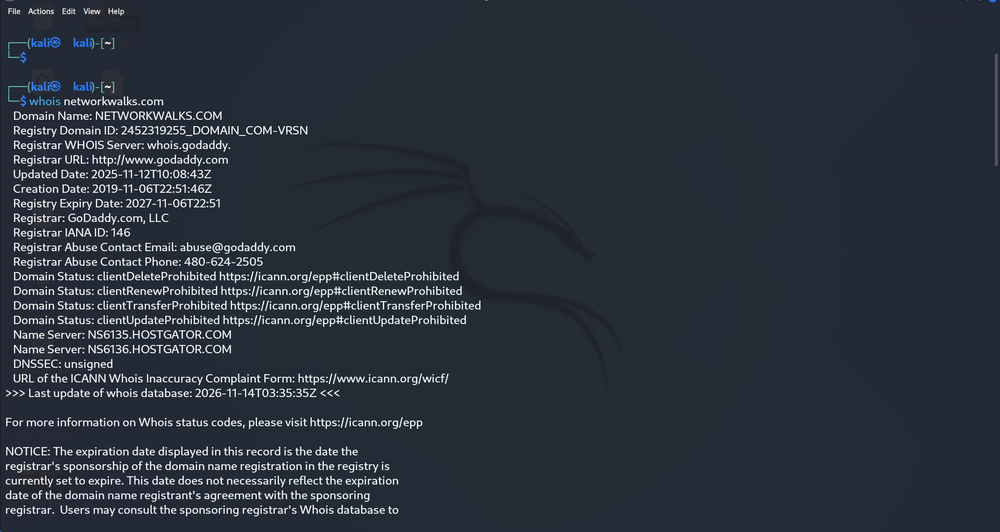
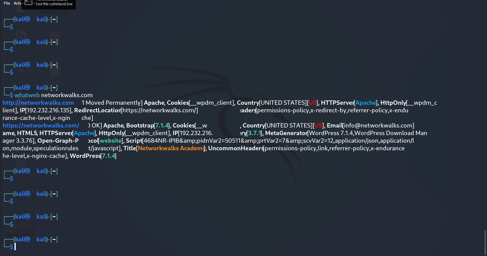
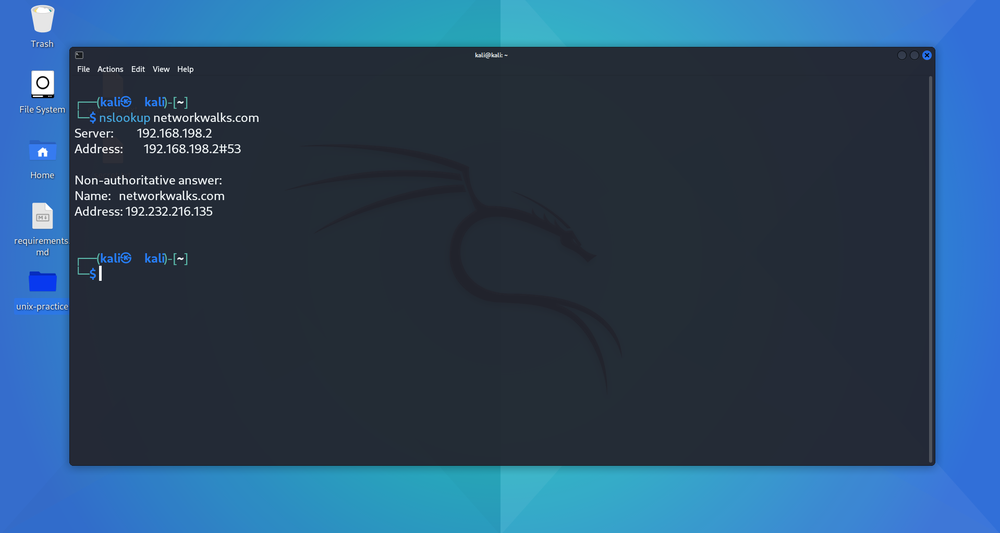
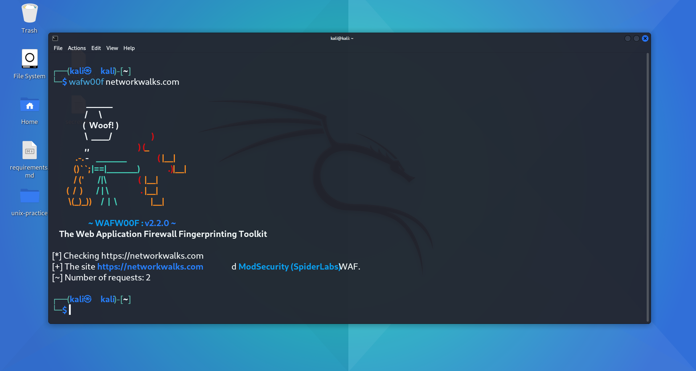
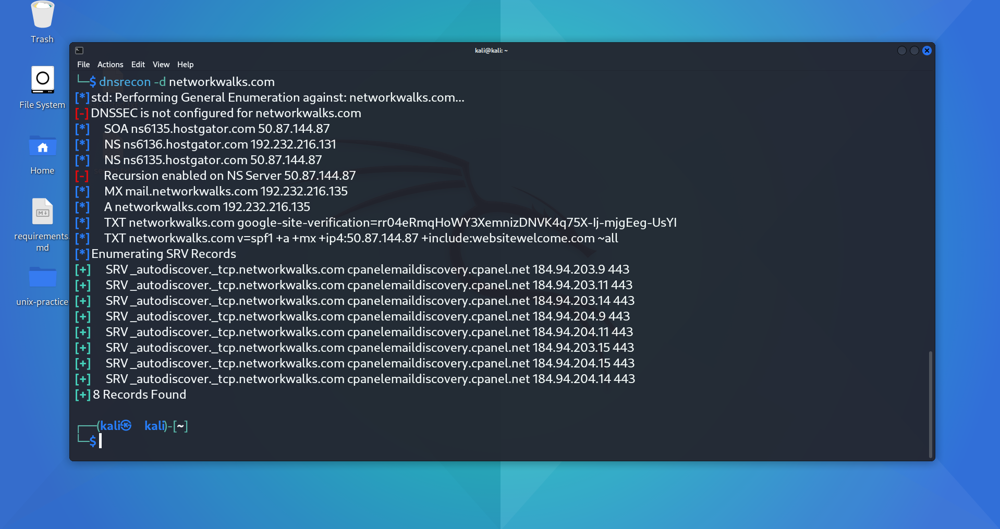

# NETWORKWALKS-B084-WK2-PM1-PM5-Reconnaissance-and-Netwrok-Scanning

**Week 02 | NetworkWalks Cybersecurity Internship | Batch B084**

A practical cybersecurity project covering domain footprinting, reconnaissance, network discovery, and topology visualization using Kali Linux, Nmap, and Zenmap.

## Overview

This project documents two practical cybersecurity activities completed during Week 02 of my NetworkWalks cybersecurity internship.

The first activity focuses on gathering publicly available information about the `networkwalks.com` domain using various reconnaissance and footprinting tools.

The second activity focuses on discovering active devices on my own local network using Zenmap, a graphical interface for Nmap, and visualizing the discovered network topology.

The objective was to understand how information gathering and network discovery contribute to the early stages of a penetration testing engagement.

## Project Objectives

- Understand the reconnaissance and footprinting process.
- Collect publicly available domain and DNS information.
- Identify web technologies and server-related information.
- Detect the presence of a Web Application Firewall (WAF).
- Discover active hosts on a local network.
- Visualize network hosts using Zenmap.
- Identify potential information exposure and security considerations.

## Lab Environment

| Component | Description |
|---|---|
| Operating System | Kali Linux |
| Reconnaissance Platform | Kali Linux Terminal |
| Network Scanning | Zenmap / Nmap |
| Domain Under Assessment | networkwalks.com |
| Local Network Target | My own local network |
| Project Type | Educational / Authorized Security Assessment |

## Tools and Technologies

| Tool | Purpose |
|---|---|
| WHOIS | Retrieve domain registration information |
| WhatWeb | Identify website technologies and frameworks |
| Nslookup | Resolve domain names and IP addresses |
| cURL | Inspect HTTP response headers |
| Wafw00f | Identify web application firewall technologies |
| DNSRecon | Enumerate DNS records |
| Zenmap | Discover hosts and visualize network topology |
| Nmap | Network scanning engine used by Zenmap |

## 1. Footprinting and Reconnaissance

Footprinting is an information-gathering activity used to collect details about a target before conducting further security assessments.

I performed reconnaissance against `networkwalks.com` using six Kali Linux tools.

### 1.1 WHOIS

**Objective:** Retrieve publicly available domain registration information, including registration details and name servers.

**Observation:** The WHOIS lookup provided domain registration and infrastructure-related information.

**Evidence:**



### 1.2 WhatWeb

**Objective:** Identify technologies and components used by the target website.

**Observation:** WhatWeb identified WordPress 7.1.4 and WordPress Download Manager 3.3.76, according to the assessment results.

**Evidence:**



### 1.3 Nslookup

**Objective:** Resolve the target domain into its associated IP address.

**Observation:** The lookup identified `192.232.216.135` as the resolved IP address at the time of testing.

**Evidence:**



### 1.4 cURL

**Objective:** Inspect HTTP response headers and identify information exposed by the web server.

**Observation:** The response headers provided additional technical information about the web application, including HTTP-related configuration details.

**Evidence:**


### 1.5 Wafw00f

**Objective:** Identify whether a Web Application Firewall protects the target website.

**Observation:** Wafw00f identified ModSecurity (SpiderLabs).

This finding identifies the detected WAF technology; it does not independently establish its effectiveness or blocking capabilities.

**Evidence:**



### 1.6 DNSRecon

**Objective:** Enumerate DNS records and collect information about the target's DNS infrastructure.

**Observation:** The assessment collected information related to name servers, mail servers, SPF/TXT records, and other DNS-related details.

**Evidence:**



## 2. Network Scanning with Zenmap

The second activity involved discovering active hosts on my own local network.

### Methodology

1. Identified the local IP address and subnet using the `ip addr` command in Kali Linux.
2. Entered the local subnet as the scanning target in Zenmap.
3. Selected the Ping Scan profile to identify responsive hosts.
4. Examined the discovered hosts and their associated network information.
5. Used the Topology tab to visualize the discovered network.

### Discovered Hosts

The report recorded the following four hosts:

| No. | IP Address |
|---|---|
| 1 | 192.168.198.1 |
| 2 | 192.168.198.2 |
| 3 | 192.168.198.254 |
| 4 | 192.168.198.128 |

These addresses represent the network results documented in the practical report. They should be verified against the final scan before publication.

### Host Discovery Evidence


### Network Topology


## 3. Risk Analysis and Potential Impact

The following table summarizes potential security considerations identified during the activities.

| Finding | Potential Impact | Risk Level |
|---|---|---|
| Web technology information exposed | May help attackers identify software versions requiring further review | Medium |
| Server IP address identifiable | Reveals information about the hosting infrastructure | Low |
| HTTP technical information exposed | May support further technology fingerprinting | Low |
| WAF technology identifiable | Provides information about the application's security architecture | Low |
| DNS infrastructure information exposed | Can help build a broader infrastructure profile | Medium |
| Multiple live hosts visible | Unknown devices may require investigation | Medium |

**Note:** These are potential risks based on reconnaissance observations, not confirmed exploitable vulnerabilities. Risk ratings reflect the original practical report.

## 4. Security Recommendations

Based on the observations, the following improvements are recommended:

1. **Review exposed technologies:** Regularly assess publicly visible information about CMS platforms, plugins, and web technologies.
2. **Maintain software updates:** Keep CMS platforms, plugins, and web technologies updated.
3. **Review HTTP headers:** Identify and minimize unnecessary technical information exposed through HTTP responses.
4. **Review DNS records:** Ensure that only required DNS records and services are publicly exposed.
5. **Maintain WAF protection:** Keep the detected WAF properly configured, monitored, and maintained.
6. **Perform regular network discovery:** Periodically identify active devices on internal networks.
7. **Investigate unknown devices:** Verify unexpected devices discovered during network scans.
8. **Maintain network documentation:** Keep network topology and device information up to date.
9. **Conduct authorized assessments:** Perform reconnaissance and scanning only with appropriate authorization.

## 5. Key Learnings

Through these practical activities, I gained experience in:

- Domain footprinting and information gathering.
- WHOIS and DNS enumeration.
- Website technology fingerprinting.
- HTTP response header inspection.
- Web Application Firewall identification.
- Internal network host discovery.
- Network topology visualization using Zenmap.
- Identifying potential information exposure and documenting security observations.

## 6. Project Structure

```text
week-02-footprinting-and-network-scanning/
│
├── README.md
│
├── report/
│   └── WEEK-2.pdf
│
├── screenshots/
│   ├── footprinting/
│   │   ├── whois.png
│   │   ├── whatweb.png
│   │   ├── nslookup.png
│   │   ├── curl-headers.png
│   │   ├── wafw00f.png
│   │   └── dnsrecon.png
│   │
│   └── network-scanning/
│       ├── zenmap-host-discovery.png
│       └── network-topology.png
│
└── documentation/
    ├── findings-and-risk-analysis.md
    └── recommendations.md
```

## 7. Disclaimer

This project was conducted for educational and research purposes as part of a cybersecurity internship.

The domain reconnaissance activity was performed with authorization, and network scanning was conducted against my own local network.

All activities documented here are intended for authorized security assessment and learning. Unauthorized scanning, access, or testing of systems and networks is not permitted.

## Author

**Murtaza Mehreyar**

Cybersecurity Intern | NetworkWalks | Batch B084

**Project:** Week 02 – Footprinting and Network Scanning

---

*This repository documents practical learning activities in reconnaissance, footprinting, and network discovery.*
